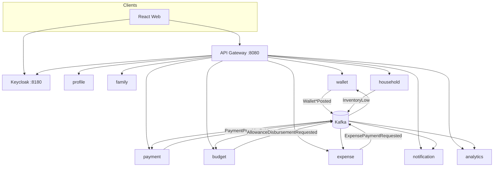
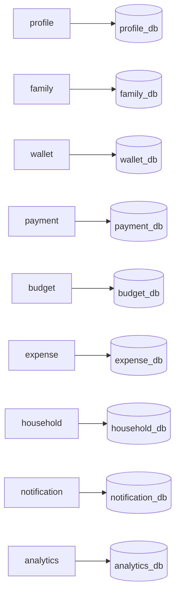
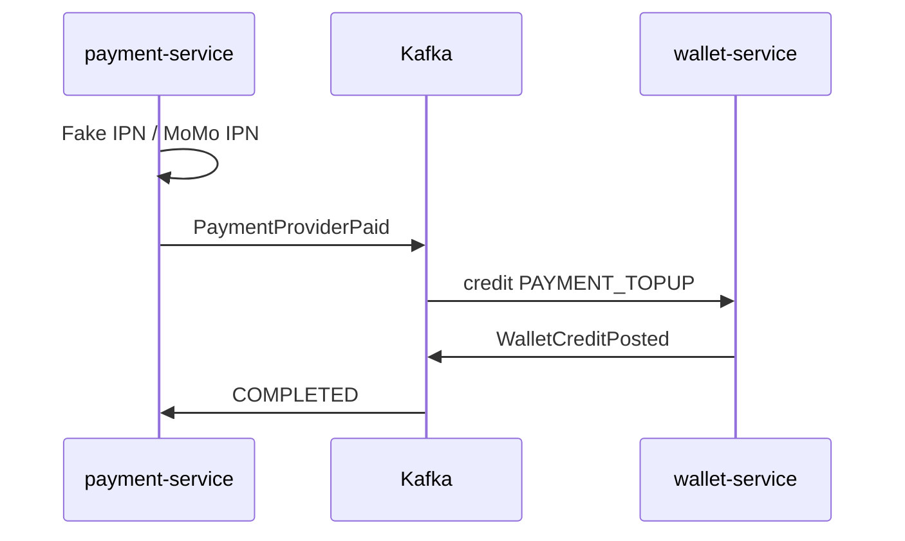

# Family Finance Platform

**Family Finance Platform** — a microservices-based household finance management system with **internal simulated wallets** and a **double-entry ledger**.

> Portfolio / demo project. **Not** a regulated bank or real-money e-wallet.  
> MoMo Sandbox ≠ production payment processing. **FakePayment** is for deterministic local demos.

*Ghi chú ngắn (VI): monorepo Java/Spring Boot + React để quản lý tài chính hộ gia đình mô phỏng; chạy local bằng Docker Compose.*

## 1. Project overview

The platform lets a family manage shared money concepts: pool wallets, member wallets, top-ups, allowances, expenses, household inventory alerts, notifications, and analytics projections.

Money is **internal ledger liability**, not deposits held for customers. Payment adapters create orders and confirmations that drive Wallet journal posts when Kafka is enabled.

## 2. Business problem and target users

**Problem:** Households need shared visibility of “who has what”, controlled allowances for members, expense settlement from family funds, and simple ops alerts (e.g. low stock)—without building a real payment institution.

**Users (roles in Family Service):** OWNER, PARENT, CHILD, VIEWER, and related membership statuses. Realm roles in Keycloak are for login demos; **family membership permissions** authorize money operations.

## 3. Key features

- Family membership and permission-checked APIs  
- Wallet accounts (`FAMILY_POOL`, `MEMBER_WALLET`, …) + double-entry journal  
- Payment top-up: FakePayment (demo) / MoMo Sandbox adapter  
- Budget allowance request → approve → (intended) Wallet `INTERNAL_TRANSFER`  
- Expense submit → Wallet `EXPENSE_PAYMENT` settlement  
- Household inventory low-stock → Notification fan-out  
- Analytics realized income/expense from **authoritative ledger events**  
- Keycloak JWT, API Gateway, Docker Compose, CI, observability profile  

## 4. Architecture summary

Database-per-service. Sync REST; async domain events via Kafka Outbox/Inbox.



Service ↔ database boundaries:



Details: [docs/architecture/overview.md](docs/architecture/overview.md) · [docs/portfolio/ARCHITECTURE_WALKTHROUGH.md](docs/portfolio/ARCHITECTURE_WALKTHROUGH.md)

## 5. Technology stack

| Layer | Verified versions / choices |
|-------|----------------------------|
| Backend | Java **21**, Spring Boot **3.3.5**, Spring Security OAuth2 Resource Server, Spring Kafka, Flyway, JPA |
| Frontend | React **19**, Vite, TypeScript, Tailwind 4 |
| Data | PostgreSQL (one DB per service) |
| Messaging | Apache Kafka (Compose) |
| Identity | Keycloak (realm `family-finance`) |
| Observability | Prometheus, Grafana, OpenTelemetry Collector, Tempo |
| CI | GitHub Actions (Maven matrix, frontend, compose-config, wallet IT=14) |

## 6. Microservices overview

| Service | Port | DB | Responsibility | Invariants / notes |
|---------|------|-----|----------------|--------------------|
| **api-gateway** | 8080 | — | JWT route to services | No business DB |
| **profile-service** | 8081 | profile_db | Provision profile from Keycloak `sub` | Profile id aligns with JWT when provisioned |
| **family-service** | 8082 | family_db | Families, members, invitations, **internal authz** | Source of membership/permissions |
| **wallet-service** | 8083 | wallet_db | Wallets, ledger, balances, outbox | **Only** service that posts money |
| **payment-service** | 8084 | payment_db | Payment orders, Fake/MoMo adapters | Provider paid ≠ wallet credit until ledger posts |
| **budget-service** | 8085 | budget_db | Budgets, allowance requests | Approve publishes disbursement request |
| **expense-service** | 8086 | expense_db | Expenses + wallet payment workflow | Requested ≠ PAID until ledger outcome |
| **household-service** | 8087 | household_db | Inventory, shopping lists | `InventoryLow` on threshold |
| **notification-service** | 8088 | notification_db | In-app notifications | Recipient policy OWNER/PARENT for inventory |
| **analytics-service** | 8089 | analytics_db | CQRS read models | Authoritative ledger events only |

## 7. Financial accounting model

Illustrative VND amounts (not real funds):

| Operation | Journal (simplified) | Event |
|-----------|----------------------|-------|
| Top-up 100 000 | DEBIT `PSP_CLEARING` 100 000 / CREDIT `WALLET_LIABILITY` 100 000 | `WalletCreditPosted` (`PAYMENT_TOPUP`) |
| Allowance 50 000 pool→member | DEBIT pool liability / CREDIT member liability | `WalletTransferPosted` (`INTERNAL_TRANSFER`) — **not** household income/expense |
| Expense 30 000 | DEBIT wallet liability / CREDIT `EXPENSE_CLEARING` | `WalletDebitPosted` (`EXPENSE_PAYMENT`) |

- Balances live in `wallet_balances` projection, updated **only** with the posting TX.  
- Posted journals are immutable; corrections use **reversals**.  
- Idempotency: ledger `idempotency_key` / `reference_id` + inbox `event_id`.  

Canonical doc: [docs/database/wallet-ledger-accounting.md](docs/database/wallet-ledger-accounting.md)

## 8. Event-driven workflows



| Workflow | Doc | Kafka E2E status |
|----------|-----|------------------|
| Payment top-up | [PAYMENT_TOPUP_SAGA.md](docs/workflows/PAYMENT_TOPUP_SAGA.md) | Implemented + smoke script |
| Expense settlement | [EXPENSE_WALLET_SETTLEMENT_SAGA.md](docs/workflows/EXPENSE_WALLET_SETTLEMENT_SAGA.md) | Implemented in code |
| Allowance disbursement | [ALLOWANCE_DISBURSEMENT_SAGA.md](docs/workflows/ALLOWANCE_DISBURSEMENT_SAGA.md) | Budget produce + wallet method exist; **wallet Kafka consumer missing** |
| Inventory low | [KAFKA_CONTRACTS.md](docs/events/KAFKA_CONTRACTS.md) | Household → Notification |
| Analytics cashflow | [analytics-metrics.md](docs/architecture/analytics-metrics.md) | Authoritative postings only |

Contracts: [docs/events/KAFKA_CONTRACTS.md](docs/events/KAFKA_CONTRACTS.md)

## 9. Security model

- Keycloak OIDC; each service validates JWT (`SECURITY_ENABLED=true` in Compose `full`).  
- Family authorization via Family internal API (`X-Internal-Api-Key`).  
- Internal wallet credit path restricted to internal roles/keys.  
- Demo users: see [infra/keycloak/README.md](infra/keycloak/README.md) (change passwords outside local demo).

## 10. Local setup

**Prerequisites:** Docker Desktop, Java 21 + Maven 3.9+ (optional for IDE runs), Node 22+ (frontend).

```bash
cp .env.example .env
# Edit .env locally — never commit secrets

docker compose up -d postgres
docker compose --profile full up -d --build

# Optional observability (combine with full so scrapes resolve)
docker compose --profile full --profile observability up -d
```

| URL | Purpose |
|-----|---------|
| http://localhost:5173 | Web (Compose `frontend` / Vite) |
| http://localhost:8080 | API Gateway |
| http://localhost:8180 | Keycloak |
| http://localhost:9090 / :3000 | Prometheus / Grafana (observability profile) |

Health: `curl -s http://localhost:8080/actuator/health`

Compose details: [infra/README.md](infra/README.md) · [local-development.md](docs/architecture/local-development.md)

## 11. Demo walkthrough

Follow [docs/portfolio/DEMO_SCENARIO.md](docs/portfolio/DEMO_SCENARIO.md) (~8–12 minutes).

Fast path (FakePayment → one wallet credit):

```bash
SECURITY_ENABLED=true KAFKA_ENABLED=true ./scripts/runtime-e2e-smoke.sh
```

## 12. Testing and CI

```bash
mvn -f services/analytics-service/pom.xml test
mvn -f services/wallet-service/pom.xml test
# Wallet IT (local Postgres or GHA service):
WALLET_IT=true WALLET_IT_JDBC_URL=jdbc:postgresql://localhost:5432/wallet_db \
  mvn -f services/wallet-service/pom.xml test -Dtest='*IT'
```

GitHub Actions (`.github/workflows/ci.yml`): `compose-config`, frontend lint/build, backend Maven matrix, **wallet-integration-tests** asserting **14** Surefire tests.

## 13. Observability

Micrometer Prometheus + OTLP tracing. Compose profile `observability` wires Prometheus, Grafana, Tempo, OTel Collector.  
Evidence of shared traces exists for gateway ↔ family in historical verification; not every saga is scripted for Tempo.

## 14. Known limitations

- Not a bank / real e-wallet; FakePayment and MoMo Sandbox are demo adapters.  
- Allowance Kafka consumer on wallet is **not present** — disbursement method exists but auto Kafka path is incomplete.  
- Analytics historical rows may be inflated until an explicit ops rebuild.  
- Kubernetes under `infra/k8s` is a **starter**, not a verified live deploy.  
- No claim of production uptime, scale benchmarks, or real MoMo production traffic.

## 15. Roadmap (honest)

- Wire `AllowanceDisbursementRequested` Kafka consumer in wallet (close Package C gap).  
- Broader Kafka broker E2E / DLT coverage.  
- Analytics rebuild tooling.  
- Harden IdP and secrets for non-local environments.  

## 16. Repository structure

```
services/          # 9 business services + api-gateway
frontend/web/      # React/Vite UI
infra/             # Compose, Postgres init, Keycloak, observability, k8s starter
docs/              # Architecture, events, workflows, portfolio
contracts/         # Event contract notes
scripts/           # Runtime smoke / security verify
```

## 17. Author / portfolio

Public repository: [HuuThanh1610/family-finance-platform](https://github.com/HuuThanh1610/family-finance-platform)

Interview-oriented material:

- [Architecture walkthrough](docs/portfolio/ARCHITECTURE_WALKTHROUGH.md)  
- [Interview questions](docs/portfolio/INTERVIEW_QUESTIONS.md)  
- [Technical decisions](docs/portfolio/TECHNICAL_DECISIONS.md)  
- [Evidence matrix](docs/portfolio/EVIDENCE_MATRIX.md)  

Historical status notes (do not rewrite as current truth): [PROGRESS.md](docs/implementation/PROGRESS.md), [FINAL_IMPLEMENTATION_REPORT.md](docs/implementation/FINAL_IMPLEMENTATION_REPORT.md).
