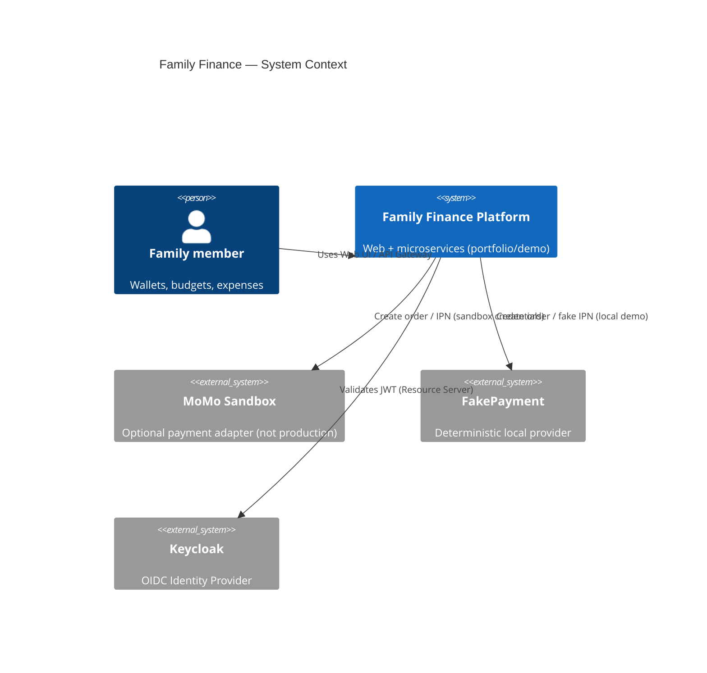
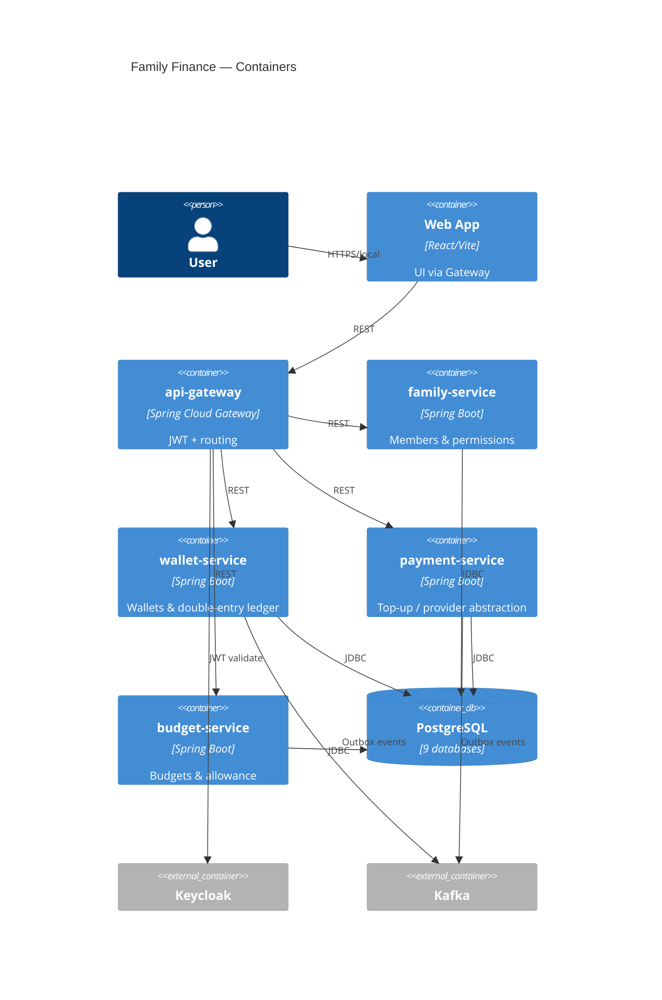
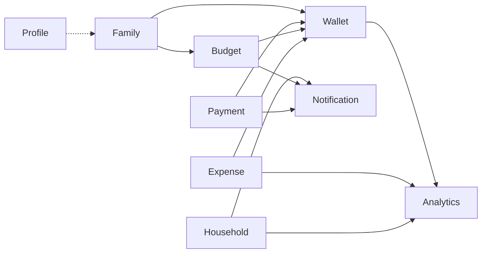

# Architecture Overview

Family Finance is a monorepo of microservices with **Database-per-Service**.

> Prefer [docs/portfolio/ARCHITECTURE_WALKTHROUGH.md](../portfolio/ARCHITECTURE_WALKTHROUGH.md) and verified source when older notes conflict.

## Bounded contexts

| Context | Service | Database |
|---------|---------|----------|
| Profile | profile-service | profile_db |
| Family | family-service | family_db |
| Wallet / Ledger | wallet-service | wallet_db |
| Payment | payment-service | payment_db |
| Budget & Allowance | budget-service | budget_db |
| Expense | expense-service | expense_db |
| Household | household-service | household_db |
| Notification | notification-service | notification_db |
| Analytics | analytics-service | analytics_db |

## Principles

- No foreign keys across databases.
- Sync via REST; async via domain events (Kafka) with transactional Outbox/Inbox.
- VND amounts as `BIGINT`; distributed ids as `UUID`.
- Web UI talks to API Gateway (`VITE_USE_MOCK=false` by default in `.env.example`).
- Wallet Service alone posts the ledger and owns balance projections.

## C4 — System Context

## C4 — Containers

## Bounded Context Map

Relations are **logical** (events/API), not FKs.

## Portfolio docs

- [README](../../README.md)
- [Demo scenario](../portfolio/DEMO_SCENARIO.md)
- [Evidence matrix](../portfolio/EVIDENCE_MATRIX.md)
- [Kafka contracts](../events/KAFKA_CONTRACTS.md)
- [Analytics metrics](analytics-metrics.md)
