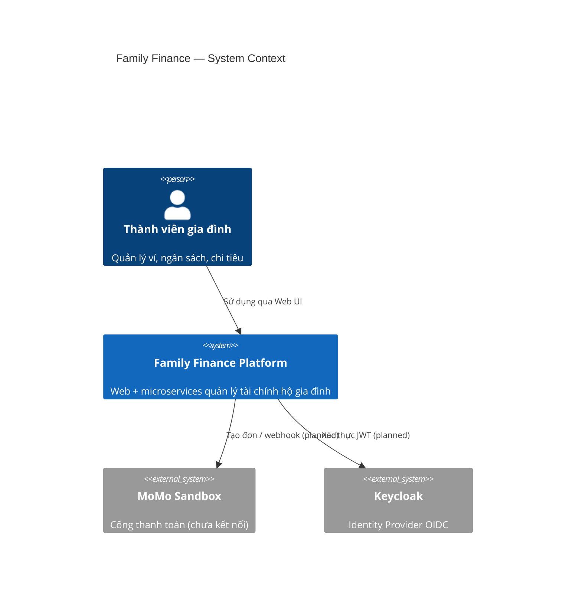
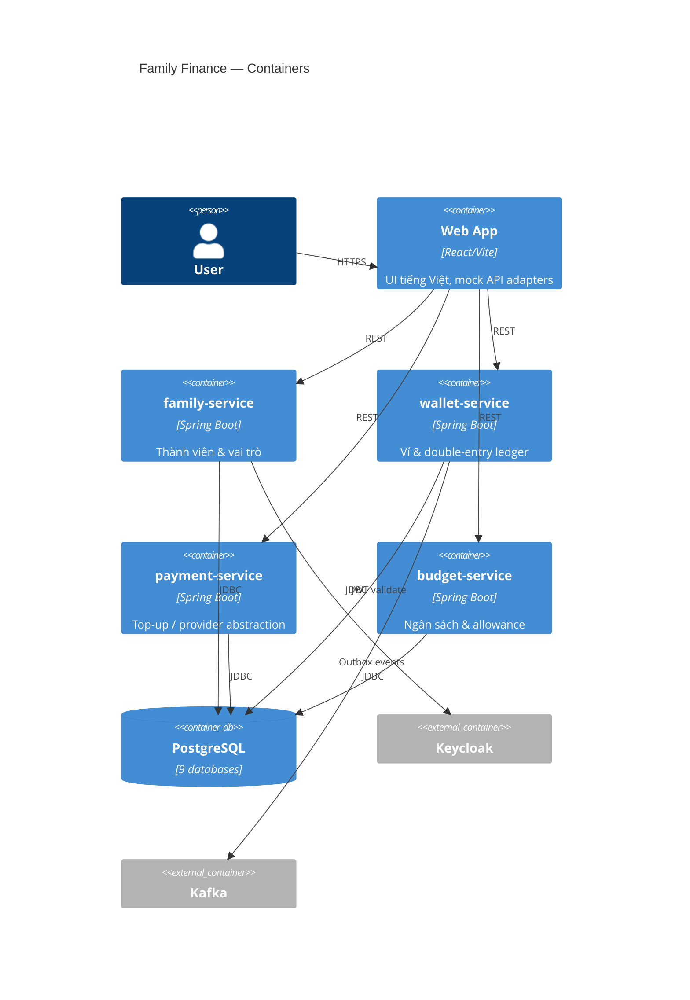
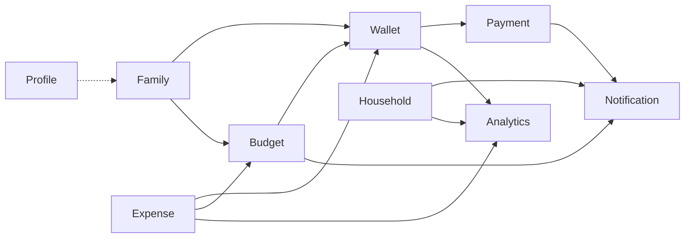

# Architecture Overview

Family Finance là monorepo microservices theo **Database-per-Service**.

## Bounded contexts

| Context | Service | Database |
|---------|---------|----------|
| Profile | profile-service | profile_db |
| Family | family-service | family_db |
| Wallet / Ledger | wallet-service | wallet_db |
| Payment | payment-service | payment_db |
| Budget & Allowance | budget-service | budget_db |
| Expense | expense-service | expense_db |
| Household | household-service | household_db |
| Notification | notification-service | notification_db |
| Analytics | analytics-service | analytics_db |

## Principles

- Không có foreign key xuyên database.
- Giao tiếp đồng bộ qua REST; bất đồng bộ qua domain events (Kafka) — schema outbox/inbox đã chuẩn bị.
- Số tiền VND dùng `BIGINT`; identity phân tán dùng `UUID`.
- Web UI chạy mock adapters cho đến khi API sẵn sàng.

## C4 — System Context

## C4 — Containers

## Bounded Context Map

Quan hệ là **logical** (events/API), không phải FK.
