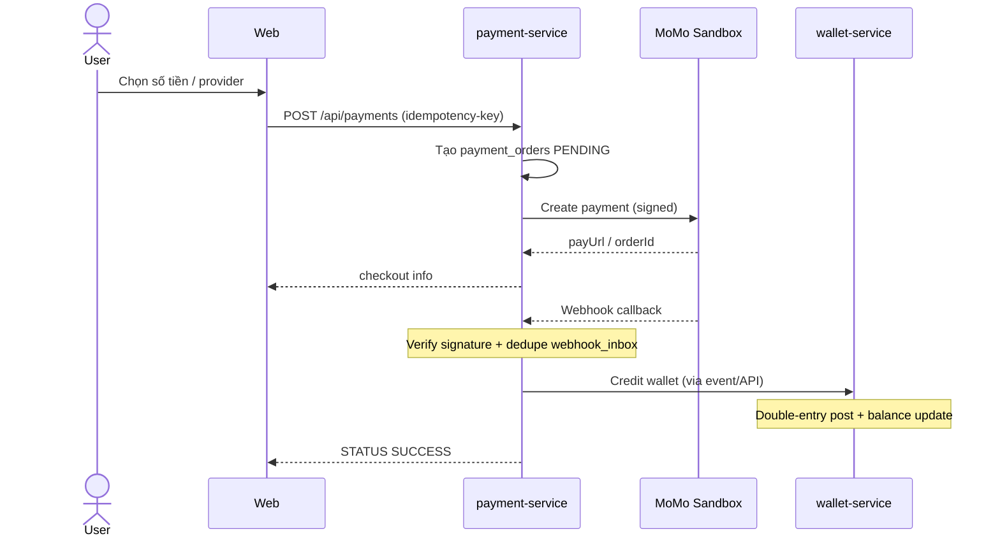
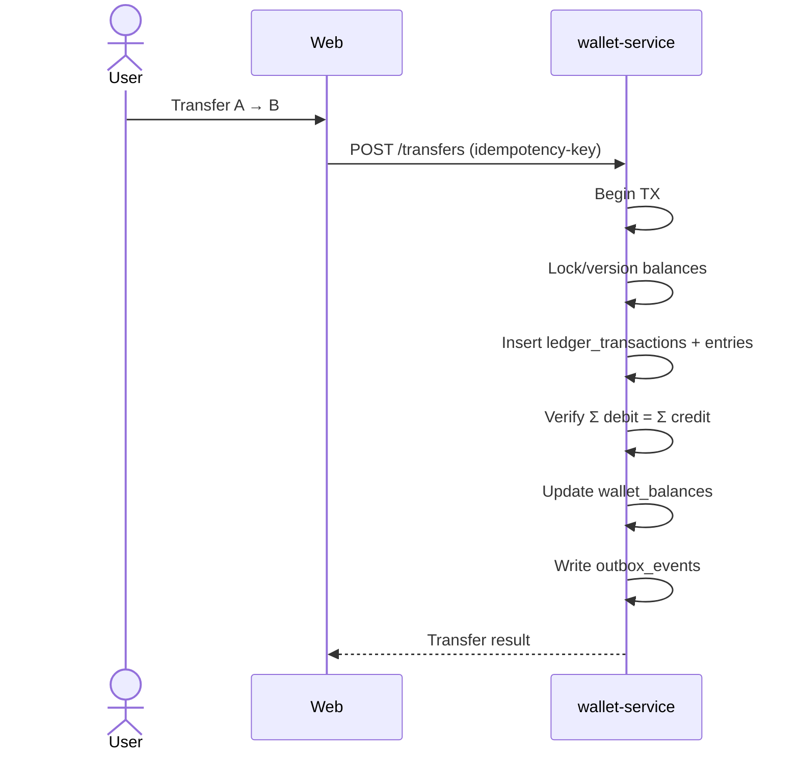

# Sequence Diagrams

## Payment top-up (planned)

**Chưa triển khai:** signing, webhook verify, wallet credit, duplicate callback protection.

## Wallet transfer (planned)

**Chưa triển khai:** posting service, locking strategy, consistency verifier.
