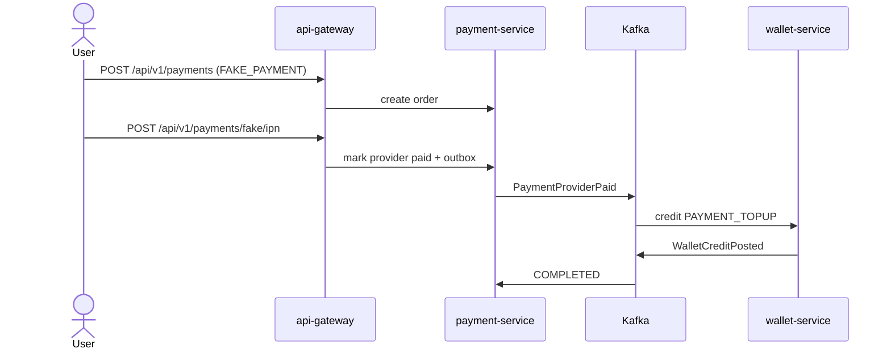
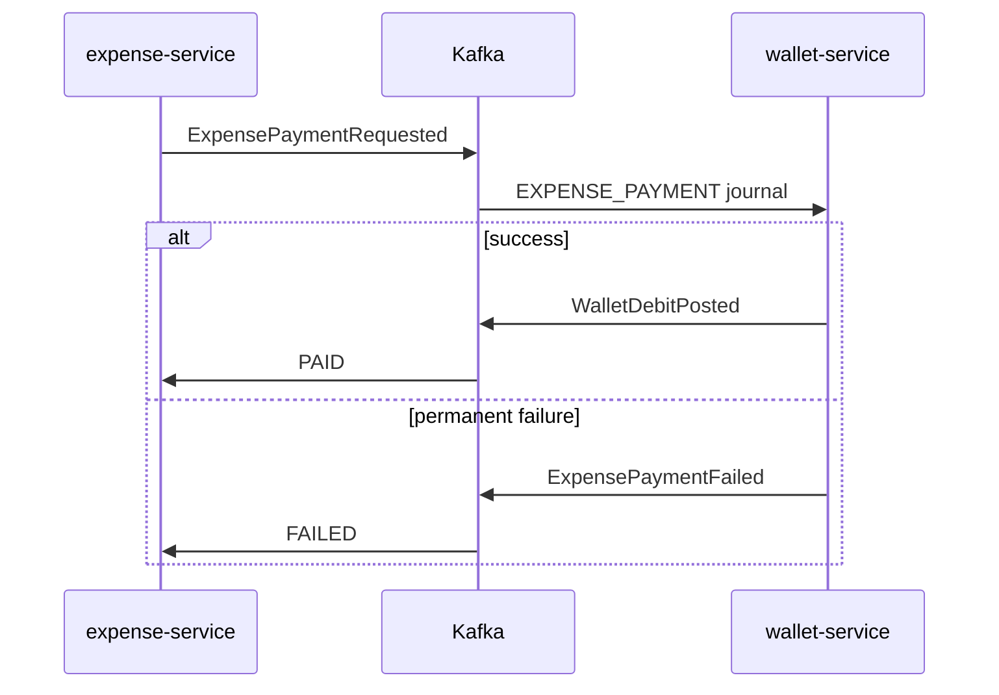

# Sequence Diagrams

Canonical workflow docs supersede older “planned” notes:

- [Payment top-up saga](../workflows/PAYMENT_TOPUP_SAGA.md) — **implemented** (FakePayment + optional MoMo Sandbox)
- [Expense wallet settlement](../workflows/EXPENSE_WALLET_SETTLEMENT_SAGA.md) — **implemented**
- [Allowance disbursement](../workflows/ALLOWANCE_DISBURSEMENT_SAGA.md) — partial (Kafka consumer gap on wallet)
- Portfolio demo: [DEMO_SCENARIO.md](../portfolio/DEMO_SCENARIO.md)

## Payment top-up (FakePayment)

## Expense settlement

