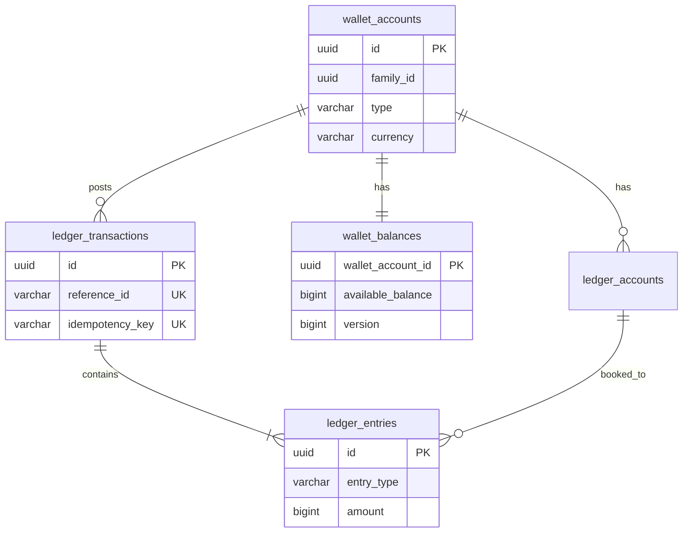
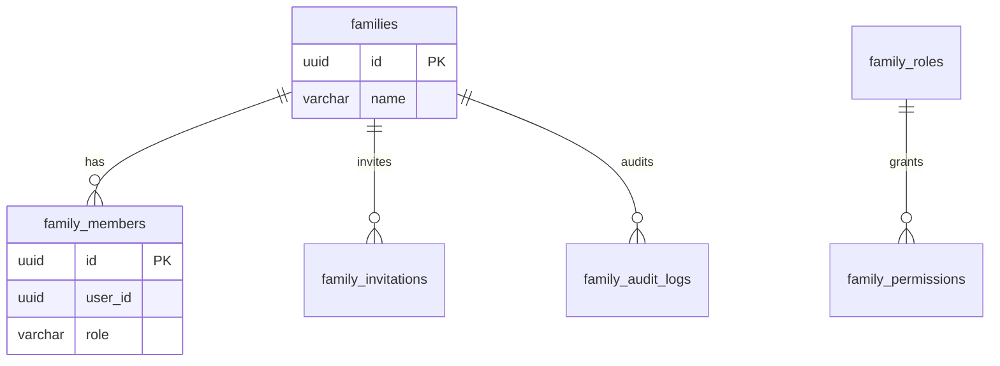
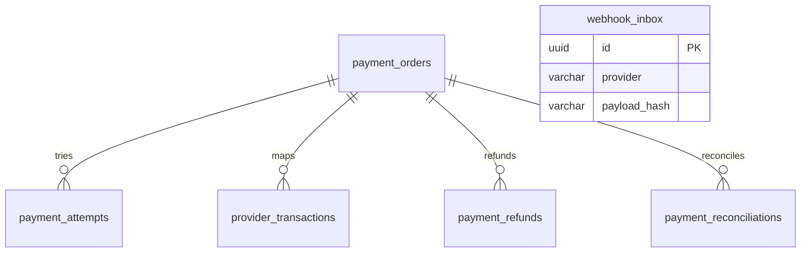
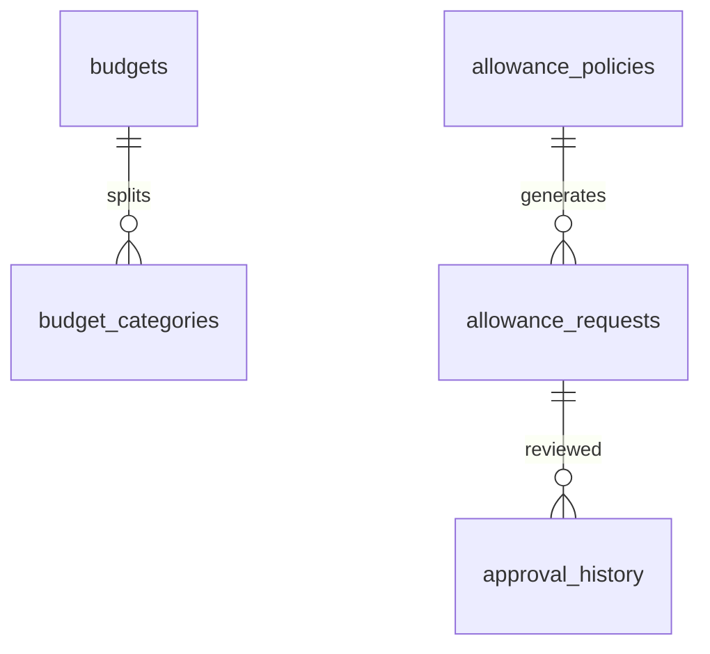

# Database ERD

## wallet_db (core accounting)

**Invariant:** với mỗi `ledger_transactions`, Σ DEBIT amount = Σ CREDIT amount (enforce ở application layer).

## family_db

## payment_db

## budget_db

Xem thêm bảng đầy đủ tại [schema-overview.md](./schema-overview.md).
